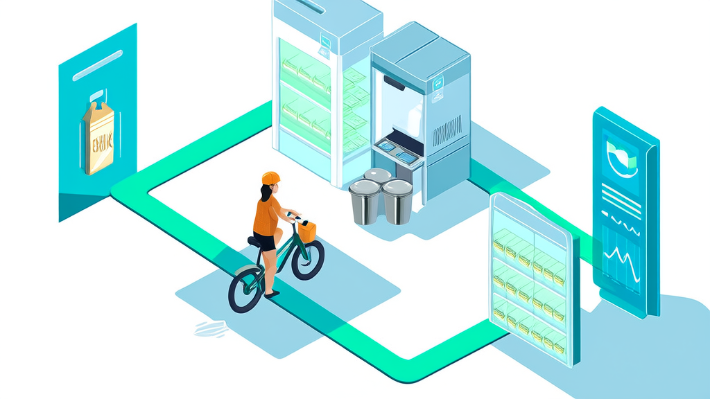

# 鲜奶订阅与社区零售一体化平台

**讯业信息鲜奶订阅平台:周期订奶系统与社区零售一体化案例**

零售/快消(乳制品与生鲜订阅零售) · 河南讯业信息科技有限公司

[📖 在线预览](https://xunyeit.github.io/xian-nai-ding-yue-yu-she-qu-ling-shou-yi-ti-hua-ping-tai/) · [🌐 公司官网](https://www.xunyeit.com) · [💼 更多案例](https://cms.xunyeit.com/)

---

## 案例摘要

河南讯业信息科技有限公司为乳企与区域经销商交付鲜奶订阅平台,以周期订奶系统为核心交易、逐日履约为管理主线,将用户、奶站、骑手与运营后台放入同一业务链路。平台整合多模式配送排期、社区围栏、门店自提核销、线上商城、会员余额与AI导购,形成社区零售一体化能力。上线后实现履约可监控、复购可运营、用户资产可沉淀,新增小区、奶站和骑手可按现有配置复制扩张。该案例表明,乳企数字化的关键不是把订奶搬到线上,而是用逐日履约确定性支撑长周期订阅信任。

## 关键成果

| 指标 | 成果 |
|---|---|
| 周期订奶订单的典型消费周期 | 30—90天以上,系统按天生成逐日履约子单 |
| 多模式配送与排期覆盖模式 | 每天送、工作日送、周末送、自定义日期4种,支持送货上门与门店自提 |
| 门店自提核销凭证 | 二维码+六位数字码双凭证,先只读预览再确认核销 |
| 平台功能模块数量 | 8个功能模块,覆盖交易侧、履约侧与角色侧 |
| 技术架构 | 前后端一体单体应用,配合MySQL、Redis、文件存储、微信服务号/JS-SDK与外部大模型服务 |
| 可披露成效维度 | 5项:履约可监控、复购可运营、用户资产可沉淀、运营效率提升、可复制扩张 |

## 鲜奶订阅平台 + 社区零售一体化：把周期订奶的履约链路装进同一条业务线

河南讯业信息科技有限公司打造的鲜奶订阅平台，以周期订奶系统为核心交易、逐日履约为管理主线，把用户、奶站、骑手与运营后台放进同一条业务链路，实现周期订奶与社区零售一体化。

周期订奶是一门“先收钱、后按天交付”的生意，真正的难点从来不在下单，而在接下来的 30 到 90 天里每天都要准确送达。平台让用户一次购买一段周期权益，系统按天生成逐日履约子单，再叠加多模式配送排期、社区围栏开通、门店自提核销与线上商城，把周期订奶与社区零售一体化落到同一条履约链路上。

这套平台带来的直接变化是三点：履约链路变得可监控，每一次送达、核销、异常都有凭证；复购从“靠人记、靠群喊”变成可运营的机制；用户、地址、订单与会话记录沉淀为平台资产，而非个人微信里的联系人。同时，新增小区、奶站与骑手只需复用现有的围栏、营业时间与收益单价配置即可扩张，让社区零售一体化具备可复制性。下文从行业挑战、客户痛点、方案设计、实施决策与成效五个层面展开。

## 行业背景与挑战：长周期、高频次、强社区属性的订阅零售，天然是履约生意

乳制品与生鲜订阅零售有三个绕不开的结构性特征。

**第一，消费周期长，履约按天拆分。** 一份订奶订单的消费周期通常在 30 天到 90 天以上，周期订奶系统必须把它拆成几十上百个逐日履约子单。这意味着用户的一次改单、一次停送、一次顺延，都会牵动后续多天的配送安排与结算方式。管理复杂度远高于普通电商的“一次下单、一次发货”。

**第二，社区属性强，配送范围按小区围栏划分。** 送奶不是全国发货，而是以小区为最小运营单元。哪个小区开通、由哪个奶站覆盖、每天几点截单、哪些日期可以自提，都是业务边界的一部分，必须由系统固定下来，而不是靠人记。

**第三，多角色在同一张订单上协作。** 用户、奶站、骑手、运营四方共同参与同一笔订单的交付：运营排期、奶站备货与核销、骑手领货与送达、用户确认与售后。任何一段脱节，最终都会演化为漏送、错送或重复核销，并且事后难以追溯责任。

在这样的业务结构下，行业的普遍起点是“微信群 + Excel + 人工排期”。这套组合在小规模时灵活，但一旦小区数、奶站数和骑手数同时增长，就会产生三类衔接问题：**交易与履约衔接不上**（订单在系统里，履约在表格里）、**线上与线下衔接不上**（周期配送与商城零售两套流程）、**角色与数据衔接不上**（订单、资金、售后分散在多张表）。乳企数字化的第一步，往往要从接上这些断点开始，而不是先增加功能，让履约协同管理成为系统的主线。

## 客户痛点：从微信群 + Excel 起步，鲜奶订阅平台缺失导致的三重业务断点

该客户同时经营周期订奶与社区零售两类业务，覆盖多个小区、多个奶站与自有及合作骑手。系统上线前，业务运行方式与行业普遍情况高度相似，也因此遇到了几乎每一个同行都会遇到的问题。

**用户资产不在自己手里。** 订奶用户的联系方式、地址、忌口与配送偏好大多散落在团长和奶站的个人微信中，复购靠人工统计，哪些用户快到期、哪些用户已流失无法及时识别。配送质量同样难以监控——用户投诉“今天没送到”，一线只能靠翻聊天记录确认。活动投放与核销脱节，发出去的优惠到底带来多少新增与续订，缺少可核对的标准。

**多角色各自为政，跨角色对账困难。** 小区覆盖范围、奶站归属、骑手排班分别记录在不同人的表格里，订单、资金与售后分散在多张表上，月底对账要靠反复比对。社区用户分布分散，周期配送走一套流程、商城零售走另一套流程，两套流程不共享统一的用户地址与履约记录，同一个用户在两边的信息可能不一致。

**自提核销无凭证，统计滞后。** 门店自提订单长期依赖微信群报单或纸质登记，核销没有可验证的凭证；营业时间与可自提日期不一致时，用户到店却取不到货；订单统计滞后，当天的核销情况要第二天才能汇总。

**一改单就难以追溯。** 用户临时改地址、要求顺延或停送，信息在群里流转，是否已落实到具体某一天、由哪个奶站执行，往往无从查证，漏送、错送与重复核销由此产生。

这些问题并非管理不努力，而是工具形态决定的：**微信群与 Excel 能够传递信息，却无法承载状态。**

## 常见问题

**周期订奶系统如何处理用户临时改单、停送或顺延?**

以逐日履约子单为单位进行变更。周期订奶订单通常覆盖30—90天,系统按天拆分为几十上百个子单;改单、顺延、未履约退款都会保留完整状态记录,可追溯到具体日期与具体约定,避免漏送、错送或重复核销。

**如何判断某个小区是否在配送范围内?**

通过社区围栏按小区多边形边界判断可配送范围。未开通小区可由用户提交登记、后台审核后开通;新增小区复用现有围栏与营业时间配置即可扩张,无需重建流程。

**门店自提怎么防止重复核销?**

二维码与六位数字码共用同一凭证,核销前先只读预览订单信息再确认扣减,并校验营业时间与可自提日期,使核销有凭证、订单统计不滞后。

**AI导购助手能替代人工客服做什么?**

支持文字、语音、拍照咨询与商品推荐、信息补全,并直接给出订单预览与支付入口,同时承接改单、顺延、退款、质量售后与投诉建议的状态流转,减少碎片化咨询对人工的占用。

**这套鲜奶订阅平台适合多大规模的业务?**

架构为前后端一体单体应用,配合MySQL、Redis与微信生态,起步轻、扩展按配置进行,适合从单城市社区起步、并逐步增加奶站与骑手的乳企与区域经销商。

**关于讯业信息,这家公司提供哪些服务?**

河南讯业信息科技有限公司专注企业数字化转型,提供软件开发、系统集成与AI智能化解决方案,官网为https://www.xunyeit.com;本案交付鲜奶订阅平台,覆盖周期订奶系统、社区零售一体化、门店自提核销、AI导购下单与奶站骑手管理等能力。

## 关于 河南讯业信息科技有限公司

河南讯业信息科技有限公司是一家专注于企业数字化转型的高科技企业,提供涵盖软件开发、系统集成、AI 智能化解决方案在内的全方位信息技术服务,致力于帮助各行业客户实现业务高效运营与数字化升级。

## 联系我们

- 公司官网:[https://www.xunyeit.com](https://www.xunyeit.com)
- 案例库:[https://cms.xunyeit.com/](https://cms.xunyeit.com/)
- 交流电话:15538271057(微信同号)

> 关键词:鲜奶订阅平台、周期订奶系统、社区零售一体化、乳企数字化、履约协同管理、门店自提核销、AI导购下单、奶站骑手管理
